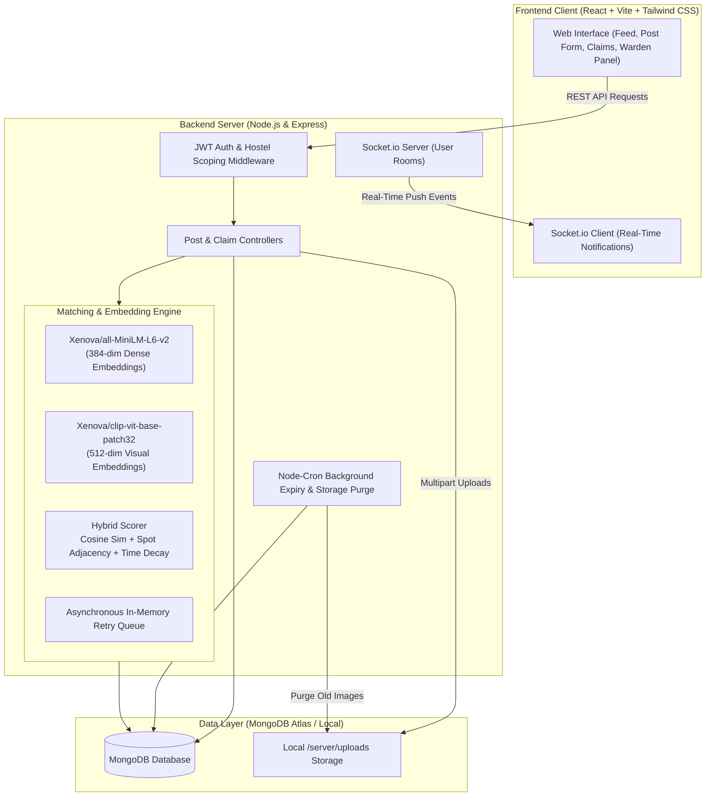

# 🏷️ Hostel Lost & Found

An intelligent full-stack MERN application designed for student residences and hostels to track lost and found belongings. The platform automates candidate discovery using **semantic text embeddings** and **visual CLIP similarity**, prevents fraudulent item recovery via a **cryptographic claim verification protocol**, and provides wardens with administrative oversight and real-time operational analytics.

---

## 📌 Problem Statement

Hostel environments face recurring losses of everyday essentials (chargers, keys, student ID cards, water bottles, earphones, umbrellas). Traditional manual bulletin boards and messaging groups suffer from:
1. **Vocabulary Mismatch**: A resident posting *"misplaced my navy blue AirPods case"* will not match someone reporting *"found a dark blue earphone sleeve"* via keyword search.
2. **False Claims & Opportunistic Theft**: Openly listing items allows malicious actors to claim expensive gadgets without proof of ownership.
3. **Cross-Building Noise**: Students in Hostel A frequently see items lost in Hostel B, polluting notification feeds.
4. **Stale Data & Clutter**: Posts remain active indefinitely, accumulating dead records and consuming server storage.

**Hostel Lost & Found** addresses these challenges with **hostel-scoped isolation**, **AI-assisted semantic & visual similarity matching**, and a **private challenge-response verification handshake** before revealing sensitive contact details.

---

## 🏛️ System Architecture



---

## ✨ Features

### 1. Multi-Tenant Scoping & Authentication
- **Hostel Isolation**: Strict scoping on all database queries ensures residents only view, claim, or match with items posted within their own hostel.
- **Warden Gated Approval**: New resident accounts require warden verification before accessing the community feed.
- **Role-Based Access Control**: Granular permissions distinguishing `residents` from `wardens`.

### 2. Dual-Channel Semantic Matching Engine
- **Dense Text Embeddings**: Powered by `@huggingface/transformers` (`Xenova/all-MiniLM-L6-v2`), converting `"title. category. description"` into 384-dimensional dense vectors.
- **Visual CLIP Embeddings**: Uses `Xenova/clip-vit-base-patch32` to calculate visual similarity across uploaded photos.
- **Location-Time Decay**: Rewards spot proximity via dynamic hostel adjacency graphs and applies exponential time decay (\(e^{-\Delta t / 3}\)).
- **Resilient Retry Queue**: Posting is non-blocking and never fails if AI models are warming up; jobs are enqueued in an asynchronous retry queue.

### 3. Claim Verification Protocol & Anti-Abuse
- **Zero-Knowledge Challenge Flow**: Finders specify 1–3 verification questions and secret `hiddenDetails` (e.g., engraving, serial number, wallpaper). Sensitive secrets are **never** returned via public endpoints.
- **Handover Contact Reveal**: Only upon claim approval are the claimant and finder's room numbers exchanged to coordinate a safe physical handover.
- **Strike System**: 3 rejected fraudulent claims suspend a resident's claiming rights until manually reset by a warden.
- **Rate Limiting**: Hard-capped at 3 claim attempts per resident every 24 hours.

### 4. Real-Time Notifications & Cron Maintenance
- **WebSockets via Socket.io**: Live notifications for high-confidence AI matches, claim submissions, approvals, and rejections.
- **Automated Lifecycle Maintenance**: Nightly `node-cron` worker automatically marks 30-day-old open posts as `expired` and purges physical image uploads for items returned more than 7 days ago.

### 5. Warden Analytics Dashboard
- Metrics tracking **Items Posted**, **Items Returned**, **Overall Return Rate %**, and **Average Resolution Time (Hours/Days)**.
- Category breakdowns and AI match engine throughput tracking.

---

## 🧮 How Matching Works

When a post is created, the system compares it against all open posts of the opposite type (`lost` vs `found`) within the **same hostel** and compatible categories.

$$\text{FinalScore} = w_{\text{text}} \cdot S_{\text{text}} + w_{\text{image}} \cdot S_{\text{image}} + w_{\text{locTime}} \cdot S_{\text{locTime}}$$

### 1. Text Similarity ($S_{\text{text}}$)
Cosine similarity between normalized 384-dimensional embeddings generated from `"title. category. description"`:

$$\cos(\mathbf{u}, \mathbf{v}) = \frac{\mathbf{u} \cdot \mathbf{v}}{\|\mathbf{u}\|_2 \|\mathbf{v}\|_2}$$

### 2. Image Similarity ($S_{\text{image}}$)
Cosine similarity between 512-dimensional CLIP image embeddings.
> **Dynamic Weight Redistribution**: If one or both items lack images, the image weight is redistributed proportionally to text and location-time scores ($w_{\text{text}} \approx 0.714$, $w_{\text{locTime}} \approx 0.286$).

### 3. Location & Time Score ($S_{\text{locTime}}$)
$$S_{\text{locTime}} = S_{\text{location}} \times S_{\text{time}}$$

- **Location Adjacency ($S_{\text{location}}$)**:
  - `1.0` if items share the exact spot.
  - `0.6` if spots are defined as adjacent in `Hostel.spotAdjacency` (e.g., Common Room $\leftrightarrow$ Mess, 1st Floor $\leftrightarrow$ 2nd Floor).
  - `0.2` for unrelated spots in the same hostel.
- **Temporal Decay ($S_{\text{time}}$)**:
  - If a found post predates the lost post by $> 14$ days: $S_{\text{time}} = 0$.
  - Otherwise, exponential half-life decay: $S_{\text{time}} = \exp\left(-\frac{\Delta\text{days}}{3}\right)$.

Matches scoring above `MATCH_THRESHOLD` (default `0.55`) are saved, retaining the top 5 candidates. Scores above `HIGH_THRESHOLD` (`0.70`) trigger real-time instant alerts.

---

## 📊 Evaluation Results: Embeddings vs. Keyword Baseline

A benchmark evaluating **50 labeled lost/found test pairs** with contrasting vocabulary (e.g., *"blue earphone case"* vs. *"AirPods cover"*, *"black steel bottle"* vs. *"dark flask"*) was executed using `server/eval/evaluate.js`:

| Metric | TF-IDF Baseline | Dense Embedding (`all-MiniLM-L6-v2`) | Absolute Improvement |
| :--- | :---: | :---: | :---: |
| **Precision@1** | 78.0% | **92.0%** | **+14.0%** |
| **Precision@3** | 90.0% | **100.0%** | **+10.0%** |
| **Mean Reciprocal Rank (MRR)** | 0.849 | **0.957** | **+0.108** |

### Benchmark Observations
- **Lexical Gap Resolution**: Keyword TF-IDF fails when students describe identical objects using different synonyms (e.g., *"spectacles"* vs. *"reading glasses"* or *"hoodie"* vs. *"pullover"*).
- **Dense Embedding Precision**: Semantic embeddings clustered items into identical topological vector neighborhoods, achieving 100% Top-3 retrieval.

---

## ⚙️ Environment Variables

### Server (`server/.env`)
| Variable | Default Value | Description |
| :--- | :--- | :--- |
| `PORT` | `5000` | Port for the Express HTTP server |
| `NODE_ENV` | `development` | Runtime environment (`development`, `test`, `production`) |
| `MONGODB_URI` | `mongodb://127.0.0.1:27017/hostel_lost_found` | MongoDB connection string |
| `JWT_SECRET` | *(Random secret string)* | Private key for signing JSON Web Tokens |
| `JWT_EXPIRES_IN` | `7d` | Token expiry duration |
| `CLIENT_URL` | `http://localhost:5173` | Allowed CORS frontend origin |
| `MATCH_THRESHOLD`| `0.55` | Minimum composite score to persist a candidate match |
| `HIGH_THRESHOLD` | `0.70` | Threshold triggering urgent WebSocket notification |

### Client (`client/.env`)
| Variable | Default Value | Description |
| :--- | :--- | :--- |
| `VITE_API_BASE_URL` | `http://localhost:5000/api` | Base URL for backend REST endpoints |
| `VITE_SOCKET_URL` | `http://localhost:5000` | Backend Socket.io connection URL |

---

## 🚀 Quickstart & Setup

### Option 1: Docker Compose (Recommended for Production / Local Dev)

Ensure Docker Desktop is installed and running:

```bash
# Clone the repository
git clone <repo-url>
cd hostel-lost-found

# Build and start MongoDB, Express Server, and Client with Nginx
docker-compose up --build
```

- **Frontend App**: [http://localhost:3000](http://localhost:3000)
- **Backend API**: [http://localhost:5000/api/health](http://localhost:5000/api/health)
- **MongoDB**: `localhost:27017`

---

### Option 2: Manual Local Development

#### Prerequisites
- Node.js 18+ (Node.js 20 LTS recommended)
- MongoDB running locally on `127.0.0.1:27017`

#### 1. Setup & Seed Backend
```bash
cd server
npm install

# Seed sample hostel, warden, residents, and 20 contrasting posts
npm run seed

# Run the test suite (47 unit & integration tests)
npm test

# Start Express server with auto-reload
npm run dev
```

#### 2. Setup Frontend
```bash
cd ../client
npm install
npm run dev
```
Open [http://localhost:5173](http://localhost:5173) in your browser.

#### Demo Credentials (Pre-Seeded)
- **Hostel Invite Code**: `HOSTEL2026`
- **Warden Login**: `warden@hostel.edu` / `Password123!`
- **Approved Resident**: `aarav@student.edu` / `Password123!`
- **Approved Resident 2**: `diya@student.edu` / `Password123!`
- **Pending Resident (To test approvals)**: `kunal@student.edu` / `Password123!`

---

## 🧪 Testing & Verification

The backend includes a comprehensive test suite covering authentication, cross-hostel scoping, scoring mathematics, claim flows, and security:

```bash
cd server
npm test
```

### Test Coverage Highlights
- `tests/phase1.test.js`: Authentication, registration with invite codes, post CRUD, image upload validation, and warden approvals.
- `tests/scoring.test.js`: Cosine similarity, spot adjacency graph penalties, exponential time decay, and proportional image weight redistribution.
- `tests/phase4.test.js`: Claim submissions, 3-strike suspension rule, 24-hour rate limiting, room number handshake disclosure, and midnight cron expiry.
- `tests/phase5.test.js`: Proves that a user from Hostel A cannot read, list, claim, or match with a post from Hostel B, confirms zero-leakage of `hiddenDetails`, and validates warden `/api/stats` calculations.

To run the offline semantic evaluation benchmark:
```bash
cd server
node eval/evaluate.js
```

---

## 📐 Design Decisions & Trade-offs

1. **Unified MERN Architecture vs. Python Microservice**:
   - *Decision*: Inlined `@huggingface/transformers` directly inside Node.js rather than maintaining a separate Python FastAPI sidecar.
   - *Trade-off*: Simplifies DevOps to a single Node.js runtime and eliminates inter-service HTTP serialization latency. High-concurrency deployments can scale out Node cluster workers or offload embeddings to an external vector pipeline.

2. **Asynchronous Non-Blocking Embedding Queue**:
   - *Decision*: When a resident posts an item, the post is saved immediately to MongoDB with empty vector embeddings, and an asynchronous task processes embeddings in the background with retry backoff.
   - *Benefit*: Resident never encounters a slow or failing request if an ONNX model is warming up.

3. **Two-Stage Handover Handshake**:
   - *Decision*: Room numbers are masked until a claim is explicitly approved by the finder or warden.
   - *Benefit*: Protects resident privacy and prevents harassment in living quarters while ensuring seamless physical item handovers.

4. **Proportional Weight Redistribution**:
   - *Decision*: Rather than failing image scoring when photos are missing, the 30% image weight is redistributed proportionally to text (71.4%) and spatio-temporal metrics (28.6%).
   - *Benefit*: Fair comparison across diverse post types without penalizing posts without photos.

---

## 🌐 Deployment Guide

### 1. Database: MongoDB Atlas
1. Create a free M0 cluster on [MongoDB Atlas](https://www.mongodb.com/atlas).
2. Create a database user and add `0.0.0.0/0` (or host IPs) to Network Access.
3. Obtain connection URI: `mongodb+srv://<user>:<password>@cluster0.mongodb.net/hostel_lost_found?retryWrites=true&w=majority`.

### 2. Backend Server: Render / Railway
1. Push the code to GitHub.
2. Create a new **Web Service** on [Render](https://render.com) pointing to the root repository with Root Directory set to `server`.
3. Build Command: `npm install`
4. Start Command: `node src/server.js`
5. Environment Variables:
   - `MONGODB_URI`: Atlas connection string
   - `JWT_SECRET`: 64-character random string
   - `NODE_ENV`: `production`
   - `CLIENT_URL`: Your deployed frontend URL
   - `MATCH_THRESHOLD`: `0.55`
   - `HIGH_THRESHOLD`: `0.70`
> *Note on Memory*: The ONNX models (`all-MiniLM-L6-v2` & CLIP) require ~512MB RAM. Ensure your Render instance provides at least 512MB–1GB RAM.

### 3. Frontend Client: Vercel
1. Create a **New Project** on [Vercel](https://vercel.com) pointing to `client`.
2. Framework Preset: `Vite`.
3. Build Command: `npm run build`
4. Output Directory: `dist`
5. Environment Variables:
   - `VITE_API_BASE_URL`: `https://your-server-app.onrender.com/api`
   - `VITE_SOCKET_URL`: `https://your-server-app.onrender.com`
6. Deploy!
