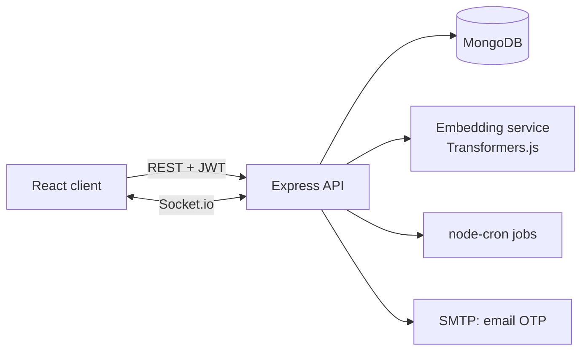

# Hostel Lost & Found

A MERN web app that reunites hostel residents with their lost belongings. Residents post lost or found items, the app **matches them automatically** using semantic text similarity plus location and time, and a **verified claim flow** makes sure items go to their real owners, with almost no manual moderation.

> **Live demo:** _add link here_ &nbsp;|&nbsp; **Demo video:** _add link here_

> All data in this repository, screenshots, and demo is **fake**. No real student data is included.

---

## The problem

In most hostels, lost and found runs on a WhatsApp group where "anyone found a black bottle?" gets buried within minutes, or on a physical desk nobody checks. Even when both sides post, they describe the same item in different words ("blue earphone case" vs "AirPods cover"), so keyword search fails and the two people never connect.

## What it does

- **Verified residents only.** Sign-up is checked against the hostel's resident roster and confirmed with an email OTP sent to the college email on file. No manual approval is needed.
- **Post lost or found items** with photos, category, spot in the hostel, and time.
- **Automatic matching.** Every new post is compared with open posts of the opposite type. Matches are ranked by a combined score of text meaning, location, and time.
- **Claim verification.** Found-item posts carry private questions only the real owner can answer. Answers are scored automatically:
  - high similarity: auto-approved
  - low similarity: auto-rejected, with a strike on the claimant
  - in between: sent to the finder to decide
- **Live notifications** (Socket.io) for strong matches, new claims, and decisions.
- **Self-moderation.** Posts that get reports from several different users are hidden automatically. Repeated failed claims trigger a timed cooldown.
- **Background jobs** expire old posts, clean up images, remind finders to hand items in, and retry failed embeddings.

## How matching works

1. When a post is saved, its text (`title. category. description`) is converted into an embedding with `all-MiniLM-L6-v2`, running inside Node.js through Transformers.js.
2. The new post is compared with every open post of the opposite type in the **same hostel**, using cosine similarity.
3. A location/time score is added:
   - same spot = 1.0, nearby spots score lower (configurable adjacency map)
   - the score decays as days pass, and drops to 0 if the found date is more than 14 days before the lost date
4. Final score:

   ```
   finalScore = 0.7 × textScore + 0.3 × locationTimeScore
   ```

   (With image matching enabled: `0.5 text + 0.3 image + 0.2 location/time`.)
5. Matches above `MATCH_THRESHOLD` are saved, keeping the top 5 per post.

### Evaluation

Keyword search is the baseline. I wrote 50 labeled lost/found pairs, each using different wording for the same item, and compared both approaches.

| Method | Precision@1 | Precision@3 |
|---|---|---|
| Keyword baseline (TF-IDF) | _fill in_ | _fill in_ |
| Embedding matcher | _fill in_ | _fill in_ |

Run it yourself:

```bash
cd server
node eval/evaluate.js
```

## How claims work

| Claim score (lowest answer similarity) | Result |
|---|---|
| ≥ `AUTO_APPROVE` (default 0.85) | Auto-approved, post marked returned |
| < `AUTO_REJECT` (default 0.40) | Auto-rejected, claimant gets a strike |
| In between | Finder is asked to approve or reject |

- 3 strikes lead to a 7-day claim block (no admin needed).
- Maximum 3 claims per user per day.
- On approval, both sides see each other's **room number** to arrange the handover. Emails and scholar numbers are never shown.

## Architecture



All of it runs as a single Node.js server. The matcher is a module inside it, not a separate service.

## Tech stack

- **Frontend:** React (Vite), React Router, Axios, Tailwind CSS
- **Backend:** Node.js, Express, MongoDB, Mongoose
- **Matching:** `@huggingface/transformers` (MiniLM for text, CLIP for images)
- **Auth:** JWT, bcrypt, email OTP (nodemailer)
- **Real-time and jobs:** Socket.io, node-cron
- **Quality:** Jest, Supertest, zod validation, helmet, express-rate-limit
- **Dev and deploy:** Docker Compose, Vercel (client), Render (server), MongoDB Atlas

## Security and privacy decisions

- **Hostel scoping on every query.** A user in one hostel can never read, claim, or match with another hostel's data. This is covered by tests.
- **Private fields are stripped.** `hiddenDetails` and expected answers are returned only to the poster and admins.
- **Roster-based sign-up with OTP.** Scholar numbers aren't secret, so identity is confirmed through the college email. The start-signup response is identical whether or not a scholar number exists, so the roster can't be probed.
- **Minimal data.** The roster holds only scholar number, room, and college email.
- **No sensitive logging.** Scholar numbers, emails, and OTPs are never logged.
- **Rate limits** on auth, claims, and reporting.

## Getting started

### Prerequisites
- Node.js 18+
- MongoDB (local or Atlas)
- An SMTP account for OTP emails (Mailtrap or a Gmail app password works for development)

### Setup

```bash
git clone <your-repo-url>
cd hostel-lost-found

# server
cd server
cp .env.example .env      # fill in the values below
npm install
npm run seed              # creates a FAKE hostel, roster, and sample posts
npm run dev

# client (new terminal)
cd client
npm install
npm run dev
```

The first run downloads the embedding model, so it takes a little longer.

### Environment variables (`server/.env`)

| Variable | Purpose |
|---|---|
| `PORT` | Server port |
| `MONGO_URI` | MongoDB connection string |
| `JWT_SECRET` | Secret for signing tokens |
| `CLIENT_URL` | Allowed CORS origin |
| `SMTP_HOST`, `SMTP_PORT`, `SMTP_USER`, `SMTP_PASS` | Email OTP delivery |
| `MATCH_THRESHOLD` | Minimum final score to create a match (default 0.55) |
| `HIGH_THRESHOLD` | Score that triggers a live "strong match" notification |
| `AUTO_APPROVE`, `AUTO_REJECT` | Claim similarity bands (defaults 0.85 / 0.40) |
| `REPORT_THRESHOLD` | Distinct reports needed to auto-hide a post (default 3) |

### Importing a real roster (for an actual deployment)

```bash
node scripts/importRoster.js path/to/roster.csv "Hostel Name"
```

CSV columns: `scholarNo, room, email`. Residents missing from a newer file are deactivated. **Never commit roster files.** They are listed in `.gitignore`.

### Tests

```bash
cd server && npm test
```

Tests cover roster-only sign-up, OTP limits, hostel isolation, private-field leaks, claim bands, strikes and cooldowns, report auto-hide, and scoring functions.

## Project structure

```
hostel-lost-found/
├── client/              # React app
├── server/
│   ├── src/
│   │   ├── models/      # Hostel, Resident, User, Post, Match, Claim, Report, Notification
│   │   ├── routes/ controllers/ middleware/
│   │   ├── services/    # embedding, scoring, matching, claims
│   │   └── jobs/        # expiry, reminders, embedding retry
│   ├── scripts/         # seed.js, importRoster.js
│   ├── eval/            # pairs.json, evaluate.js
│   └── tests/
├── docker-compose.yml
└── README.md
```

## Design decisions and trade-offs

- **Embeddings in Node, not a Python service.** Keeps the whole app one language and one deployment. Transformers.js is slower than Python, but a hostel's post volume is small.
- **Plain arrays and cosine similarity instead of a vector database.** At a few hundred posts, a vector DB adds complexity with no benefit.
- **Three-band claim decisions.** Fully automatic approval risks wrong handovers, so the middle band goes to the finder.
- **Timed cooldowns instead of manual resets,** so no admin is needed for routine abuse.
- **Multi-hostel data model from day one.** Every record carries a `hostel`, so supporting more hostels needs no rewrite.
- **Small evaluation set.** 50 pairs is enough to show the trend, not to claim production accuracy.

## Roadmap

- [ ] CLIP image matching and photo-based category suggestion
- [ ] Match a found ID card to its owner through the roster
- [ ] In-app chat for handover
- [ ] Borrow/lend board for everyday items (chargers, irons, buckets)
- [ ] PWA with push notifications

## Author

**Rihansh** &nbsp;·&nbsp; _add GitHub, LinkedIn, and email links_

## License

MIT
